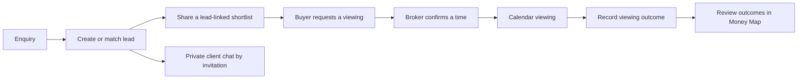

# Atrium workflows

This document maps the buyer journey across the CRM, client links, and Ops. The first build connects shortlists to leads and lets a buyer request a viewing. [Product goals and roadmap](PRODUCT.md)

## Who does what

| Actor | Where they work | Responsibilities |
| --- | --- | --- |
| Broker | CRM | Log enquiries, manage the lead, share properties, follow up, and schedule and record viewings. |
| Brokerage owner or admin | CRM | Set up the brokerage's channels and inventory practices, oversee the pipeline, and review outcomes and spend. |
| Buyer | Client links | Open a shared shortlist or redeem a separate client chat invitation without creating an account. |
| Platform operator | Ops | Provision brokerages and issue owner or admin invitations. Invitees accept through the CRM. |

## Buyer journey

The diagram shows the proposed end-to-end journey. The table describes which handoffs exist today.

| Handoff | In Atrium today | Proposed for the pilot |
| --- | --- | --- |
| Enquiry → Lead | A broker can log an enquiry. Lead Fuse matches an existing lead on phone and adds the enquiry to its source history. Staff can review and merge duplicates. | Use the lead detail as the starting point after capture and duplicate resolution. |
| Lead → Shortlist | A broker selects listings, creates a share link, and can reopen the saved shortlist. The public page shows the selected properties and tracks opens. The optional client name is a label. | Add an optional lead association. Prefill it when creating from a lead and show the lead's shortlists in its detail view. |
| Lead → Client chat | The assigned broker can issue a link and share it directly. Messages and attachments stay with the lead's conversation. The broker can require a PIN and revoke access. | Use the existing chat entry point from the lead for private follow-up during the pilot. |
| Shortlist → Viewing request | The client can browse the shared properties. Brokers can schedule viewings from Leads or Calendar. | Let the buyer choose a property and send a viewing request. Surface the pending request on the lead so the assigned broker can act. |
| Confirmed time → Calendar | A Calendar viewing can be linked to both a lead and a listing. Scheduling moves a `NEW` or `QUALIFIED` lead to `VIEWING`. | Confirm a request with an agreed date and time and create one linked Calendar viewing. |
| Viewing → Outcome | A broker can mark a viewing held, cancelled, or a no-show, with feedback or a cancellation reason where applicable. | Use the existing outcome controls. Show the confirmed viewing and its outcome on the lead. |
| Outcome → Money Map | Money Map uses completed viewings, won deals, and entered spend. An outcome can receive credit under each previously recorded source for the lead. Combined totals deduplicate outcomes. | Keep requests and appointments out of the completed-viewing count until the broker records a held outcome. |

Supporting workflows feed the same records. Listings are maintained under Inventory. Guides can generate an enquiry linked to a new or existing lead. Ops provisions access before the team works in the CRM. Campaign attribution is on the [product roadmap](PRODUCT.md#campaigns-planned).

## First build

### 1. Link a shortlist to a lead

- From a lead, choose **Create shortlist** and select properties from the brokerage's inventory. From **Shortlists**, allow an existing lead to be selected or the shortlist to be saved on its own.
- Keep standalone and previously shared shortlists usable. A broker can link a standalone shortlist to an existing lead. Staff views show the relationship, while the share link continues to show the chosen properties and client-facing text.
- Check that the lead, shortlist, and listings belong to the brokerage. Apply the lead and shortlist access checks on the server.
- When leads are merged, move their linked shortlists and viewing requests to the surviving lead. Keep existing share URLs valid. Preserve the current rule that a lead with a private chat must be kept as the survivor or left separate.

### 2. Request and confirm a viewing

- On a lead-linked shortlist, the buyer chooses **Request a viewing** on a property and can provide availability and a short note. The page confirms receipt and tells the buyer the broker will confirm a time.
- Start the request as **Pending**. Link it to the shortlist, its lead, and the selected property. The assigned broker sees the request on the lead and can review it before acting.
- A shared link can be forwarded. Treat it as permission to submit a request. The broker confirms the buyer and time through their existing contact channel before booking.
- The broker can **Confirm** with an agreed time or **Decline**. Confirmation creates a Calendar viewing and saves its ID on the request. Retrying confirmation returns the same viewing. A declined request keeps its history.
- If plans change, edit or cancel the linked Calendar event. Keep both the original request and the Calendar history available from the lead.

## Pilot acceptance

1. Two enquiries for the same phone leave one lead with both source entries. The broker creates and shares a shortlist from that lead.
2. A signed-out buyer opens the shortlist, picks one of its properties, and sees that their request is awaiting confirmation. Retrying the same submission keeps one pending request. A listing outside the shortlist is rejected.
3. The assigned broker sees the request on the lead and confirms a time. A second confirmation leaves one Calendar event linked to the same lead and property. Rescheduling changes that event.
4. A declined request creates no Calendar event. A cancellation or no-show creates no held-viewing credit. Marking the confirmed viewing held counts it once in the combined Money Map total.
5. Merging duplicate leads preserves the linked shortlist and request on the surviving lead. A different brokerage cannot access those records or confirm the request.
6. A standalone shortlist still opens. Opening or forwarding a link creates no lead or appointment. Lead notes, contact details, and chat history stay inside their authorized views.

## Decisions before implementation

- **Staff permissions.** The proposed default is that the assigned broker handles requests. Decide whether owners and admins can also confirm them and how unassigned leads surface pending requests.
- **Public link controls.** Shortlist URLs currently have no expiry or revoke action. Decide how a broker disables viewing requests from a forwarded or retired link and whether the buyer should still be able to browse the properties.
- **Broker notifications.** Start with pending requests visible on the lead. Decide whether the pilot also needs an inbox count to keep requests from going unnoticed.

Chat invitations use a separate policy. An invite is single-use, can expire in 1–30 days or have no invite expiry, and can require a separately shared PIN. Redemption creates a 30-day chat session. Revoking access invalidates both invitations and sessions for the conversation.
